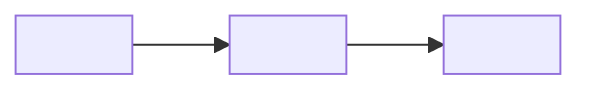
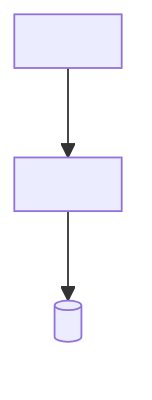
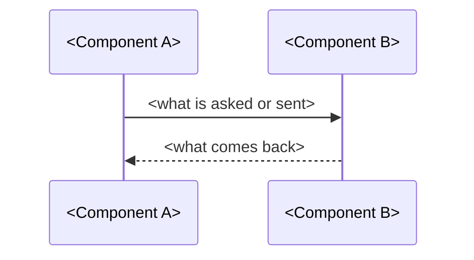

# <Project or change>: HLD

Status: <proposed | approved> · Revision: <n> · PRD: <approved revision>

This document shows the components and how they interact. Code-level detail belongs in the LLD.
Diagrams are written in Mermaid.

## Context and scope

The system is <what it is, who uses it and which outside systems it talks to>. The goals and the
scope come from the PRD: <link its goals and out-of-scope list>.

## Assumptions and constraints

- <An assumption the design relies on>.
- <A constraint, such as a platform, a budget or a rule, and what it rules out>.

## Architecture

| Component | Responsibility | Talks to (how) |
|---|---|---|
| <component> | <One sentence on what it does>. | <It calls a component over a protocol>. |

## Key interactions

### <Scenario>

Failure: <what happens when a step fails, and what the user sees>.

## Data and interfaces

- Data: <the main kinds of data, which component owns each, and where it flows>.
- External interfaces: <each one to a person or an outside system, by purpose and protocol>.
- Internal interfaces: <each one between components, by purpose and protocol>.

## Cross-cutting concerns

- Security and privacy: <where trust changes, what guards it, and where sensitive data may go>.
- Performance and reliability: <the PRD's targets, and how the design meets them>.
- Observability: <what is logged or measured, and who reads it>.
- Testing: <the levels of testing, and what each proves>.
- Deployment and operation: <how it is shipped, configured and run>.

## Alternatives and decisions

- Alternative: <an option, including doing nothing>, which loses because <reason>.
- D-1 (<date>): <The decision>. Context: <why it came up>. Consequences: <what follows>.

## Traceability and risks

| Requirement | Components |
|---|---|
| FR-1 | <components> |

- Risk: <a risk>, mitigated by <its mitigation>.

## Glossary

- <Term>: <what it means>.
