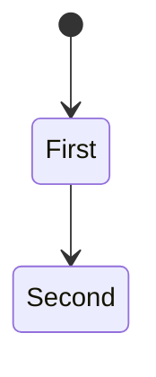
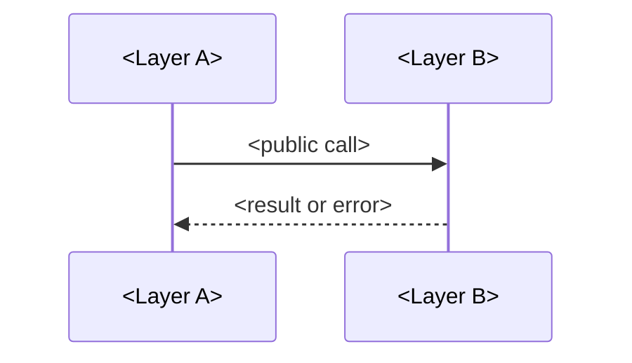

# <Project or change>: LLD

Status: <proposed | approved> · Revision: <n> · PRD: <approved revision> · HLD: <approved revision>

This document says how each HLD component is built, at the level a team needs to agree on before
coding. Code-level detail is limited to new files, design patterns and the public interfaces
between layers and packages. Logic inside a file is left to code review. Diagrams are in Mermaid.

## <Component>

- Responsibility: <one sentence>.
- New files: <each new file and what it holds>.
- Design pattern: <the pattern it uses, and why>.
- States and errors: <the states it moves through, and how its errors reach callers>.

## Public interfaces between layers

- <Layer or package A> calls <B> through <interface>, with <inputs>, <outputs> and <errors>.
- Data that crosses the boundary: <an API field or stored format, and who owns it>.

## Rollout and rollback

- <How the change ships, how stored data moves, and how to undo it>.

## Test plan

| Requirement | What the test proves | Level |
|---|---|---|
| FR-1 | <What behavior it shows>. | <unit> |

## Pull requests

1. <The first slice, its new files and its checks>.
