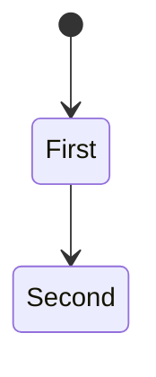
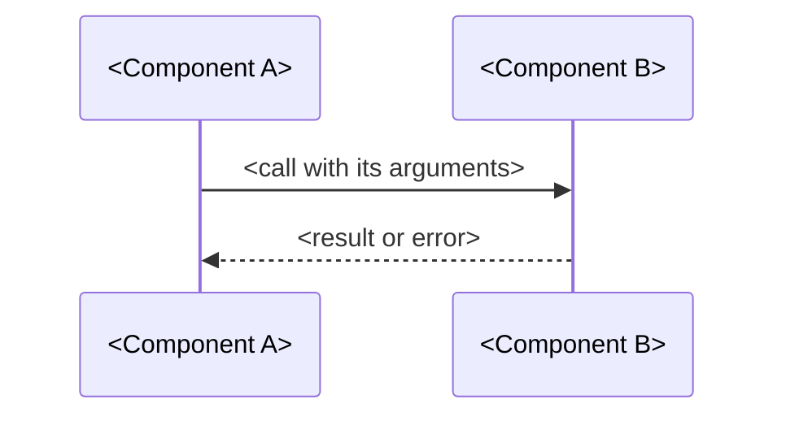

# <Project or change>: LLD

Status: <proposed | approved> · Revision: <n> · PRD: <approved revision> · HLD: <approved revision>

This document says how each HLD component is built, so a team can build and test it without
guessing. Diagrams are written in Mermaid.

## <Component>

- Responsibility: <one sentence, and the files it adds or changes>.
- Data model: <the types, fields and invariants it owns>.
- Interface: <each function, endpoint or command, with inputs, outputs and errors>.
- Behavior: <the main flow and each edge case>.

## Interactions in detail

## Errors, logging and security

- <What can fail, how it is retried or reported, what is logged, and what is checked>.

## Rollout and rollback

- <How the change ships, how stored data moves, and how to undo it>.

## Test plan

| Requirement | Test | Level |
|---|---|---|
| FR-1 | <The test, and what it proves>. | <unit> |

## Pull requests

1. <The first slice, its files and its checks>.
